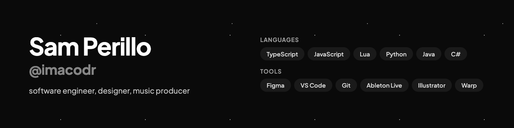

### hey, I'm Sam 👋

software engineer, product designer, and music producer. I build creative, immersive software — things that give people a small sense of wonder.

**Software Development** student at *** The University of Utah***

**currently building**
- [Uai](https://runuai.com) — teams of AI agents that plan, build, and review code in parallel, on your own machine
- [Memoria](https://runmemoria.com) — live dashboards for high-volume school events
- Grammar Police vs Criminals — a 2–8 player party game with real-time multiplayer

**open source (Roblox)**
- Texturebox — store and reuse textures across projects
- Fetchu — a lightweight wrapper around HTTPService
- RSS — style Roblox UI with CSS-like syntax
- moblox — a Discord bot for managing Roblox groups

**previously** Gr4de (5th nationally, FBLA 2024) · Pyramid (11th nationally, FBLA) · Grammar Police (5.0 on the App Store)

TypeScript · JavaScript · Lua · Python · Java · C#

[samperillo.com](https://samperillo.com) · [X](https://x.com/skperillo) · [LinkedIn](https://linkedin.com/in/samperillo) · sam@perillo.dev

 

*software for the good minded :)*
